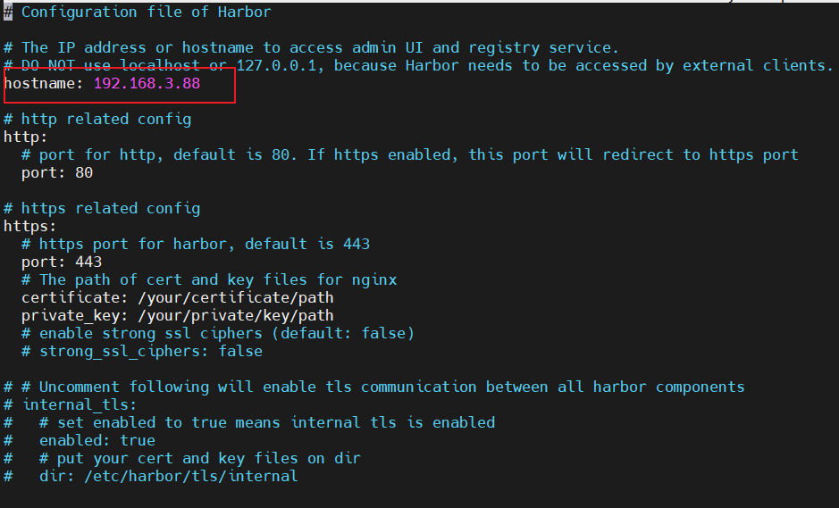
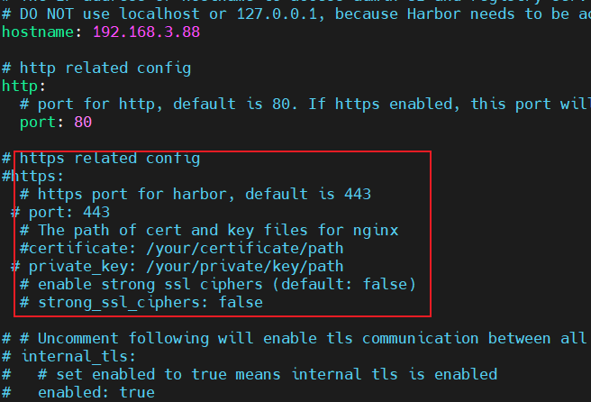
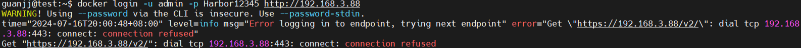

<!--
 * @Author: guanjiajun www.guanjiajun@ewake.com
 * @Date: 2024-07-16 13:24:09
 * @LastEditors: guanjiajun www.guanjiajun@ewake.com
 * @LastEditTime: 2024-07-16 20:08:11
 * @FilePath: \studys\programming\linux\debian12\debian,docker安装.md
 * @Description: 这是默认设置,请设置`customMade`, 打开koroFileHeader查看配置 进行设置: https://github.com/OBKoro1/koro1FileHeader/wiki/%E9%85%8D%E7%BD%AE
-->
<https://blog.csdn.net/qq_67733273/article/details/132799033>
方式1
```shell
# 删除旧版本
sudo apt-get remove docker docker-engine docker.io
1
# 更新系统
apt update
apt upgrade -y

# 安装Docker前准备
apt install curl vim wget gnupg dpkg apt-transport-https lsb-release ca-certificates

# 设置Docker的GPG公钥
curl -sSL https://download.docker.com/linux/debian/gpg | gpg --dearmor > /usr/share/keyrings/docker-ce.gpg
# 上面不行
curl -sS https://mirrors.tuna.tsinghua.edu.cn/docker-ce/linux/debian/gpg | gpg --dearmor > /usr/share/keyrings/docker-ce.gpg
# 为Docker设置清华源
echo "deb [arch=$(dpkg --print-architecture) signed-by=/usr/share/keyrings/docker-ce.gpg] https://mirrors.tuna.tsinghua.edu.cn/docker-ce/linux/debian $(lsb_release -sc) stable" > /etc/apt/sources.list.d/docker.list

# 安装Docker
apt update
apt install docker-ce docker-ce-cli containerd.io docker-compose-plugin

# 配置Docker
# 查看Docker版本
docker version

# 启动docker
sudo systemctl start docker

# 检测docker状态
systemctl status docker
 
# 设置docker开机自启动
sudo systemctl enable docker

# 配置普通用户权限
# 添加docker组
sudo groupadd docker
 
# 添加用户至docker组
sudo usermod -aG docker $USER
 
# 更新docker组
newgrp docker

```
方式2(docker.io debian维护，上面官方维护)
```shell
# 安装Docker
sudo apt install docker.io

# 开机自启动
sudo systemctl enable --now docker
```

harbor安装
<https://goharbor.io/docs/2.11.0/install-config/installation-prereqs/>

通过https://github.com/goharbor/harbor/releases获取最新版下载地址
```shell
wget https://github.com/goharbor/harbor/releases/download/vX.X.X/harbor-offline-installer-vX.X.X.tgz
tar xzvf harbor-online-installer-version.tgz

```
修改配置
```shell
# 修改hostname
cp harbor.yml.tmpl harbor.yml
nano harbor.yml

```

不使用https，注释https部分

```shell
# 确认可以安装（离线安装包可以不执行此步骤）
./prepare

# 安装
./install.sh
# 验证，注意：在执行docker compose相关命令时，需要进入到docker-compose.yml所在的目录下。
# docker ps列出了docker引擎中所有正在运行的容器。
# docker compose ps列出了与docker compose文件中声明的映像相关的容器。
# docker compose ps的结果是docker ps结果的一个子集。
docker compose ps
访问地址：http://192.168.3.88
用户名：admin
密 码：Harbor12345

# 推送镜像前登录
docker login -u admin -p Harbor12345 http://127.0.0.1
# 下载官方镜像
docker pull mysql:5.6
# 给镜像打标签
docker tag mysql:5.6 127.0.0.1/gulimall/mysql:5.6
# 上传
docker push 127.0.0.1/gulimall/mysql:5.6
#下载
docker pull 192.168.3.88/gulimall/mysql:5.6
```

客户端登录haebor失败
```shell
# 修改客户端
nano /etc/docker/daemon.json

# 添加如下
{
"insecure-registries" : ["192.168.3.88", "0.0.0.0"]
}
systemctl restart docker

# Stop Harbor.会删除镜像
docker compose down -v
# Restart Harbor.
docker compose up -d

# 重启

docker compose restart
```