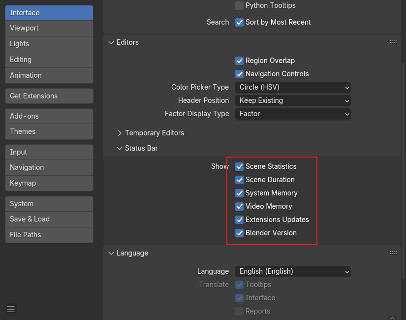
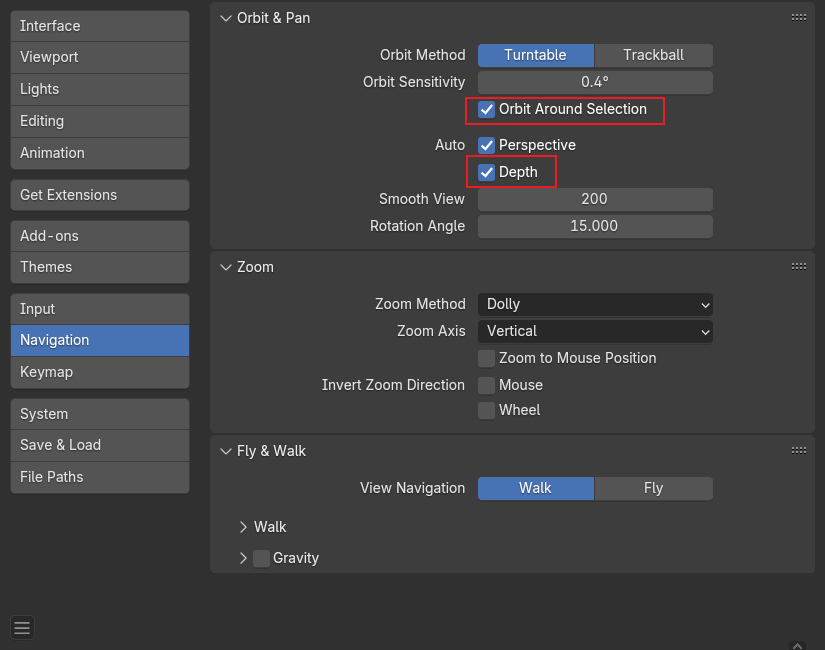
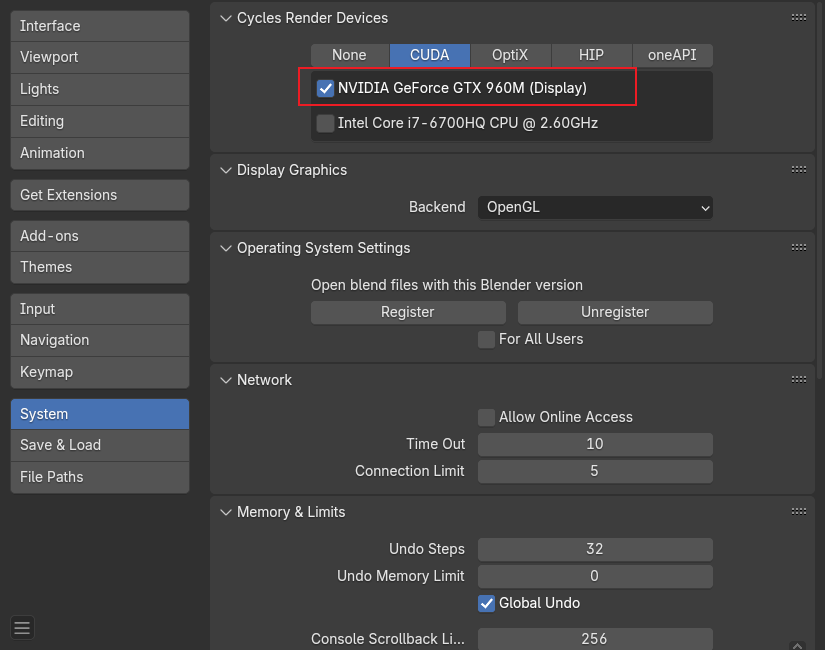
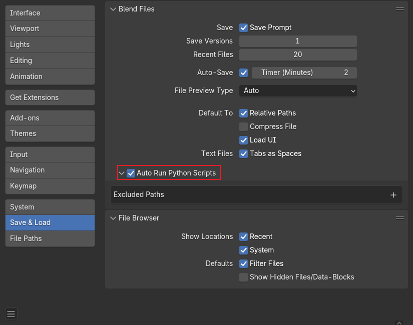

<!--
 * @Author: guanjiajun www.guanjiajun@ewake.com
 * @Date: 2025-05-20 16:27:08
 * @LastEditors: guanjiajun www.guanjiajun@ewake.com
 * @LastEditTime: 2025-05-20 16:57:33
 * @FilePath: \studys\programming\图形学\blender\blender安装设置\blender安装设置md
 * @Description: 这是默认设置,请设置`customMade`, 打开koroFileHeader查看配置 进行设置: https://github.com/OBKoro1/koro1FileHeader/wiki/%E9%85%8D%E7%BD%AE
-->
- [blender安装设置](#blender安装设置)

### blender安装设置
- 初次启动界面保持默认即可

- 为方便操作进行一些常用的设置

显示更多模型信息，性能使用情况

根据选择物体进行旋转

各个tab点一下，设置要使用的显卡

