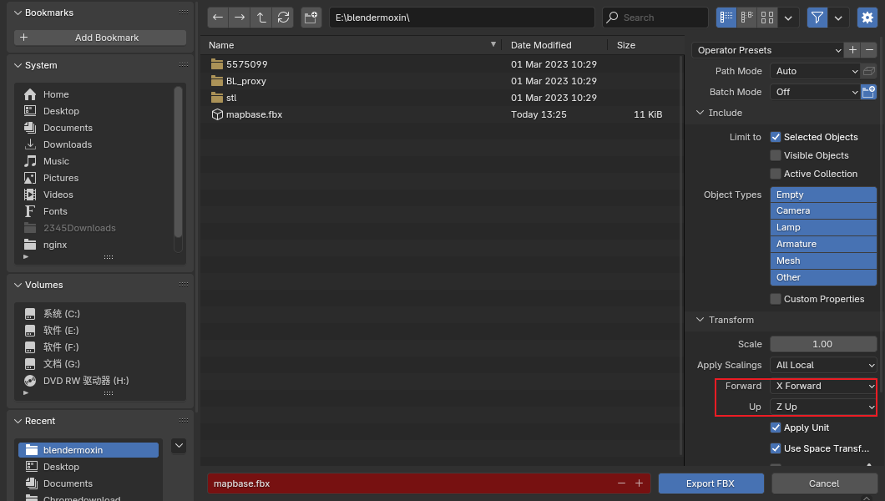
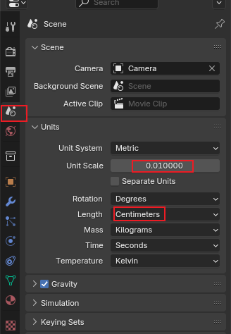

<!--
 * @Author: guanjiajun www.guanjiajun@ewake.com
 * @Date: 2025-07-03 09:47:50
 * @LastEditors: guanjiajun www.guanjiajun@ewake.com
 * @LastEditTime: 2025-07-03 13:36:39
 * @FilePath: \studys\programming\图形学\ue\blender、ue互导.md
 * @Description: 这是默认设置,请设置`customMade`, 打开koroFileHeader查看配置 进行设置: https://github.com/OBKoro1/koro1FileHeader/wiki/%E9%85%8D%E7%BD%AE
-->
## FBX（网格、材质、骨骼、动画等）
### 朝向
* blender z朝上 -y向前
* ue z朝上 x向前

导出时调整

### 比例
* ue导入blender会放大100倍，可按下图设置调整

* blender导入ue，可按上图设置调整，在通过放大缩小调整模型尺寸到正常尺寸