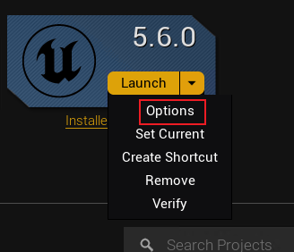
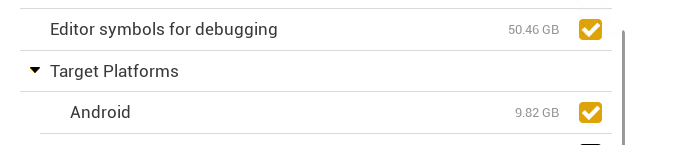
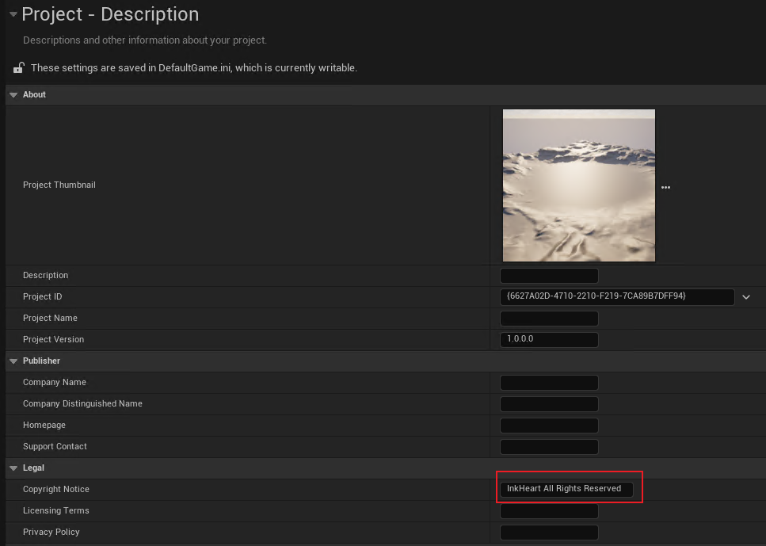
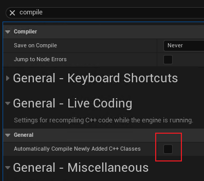
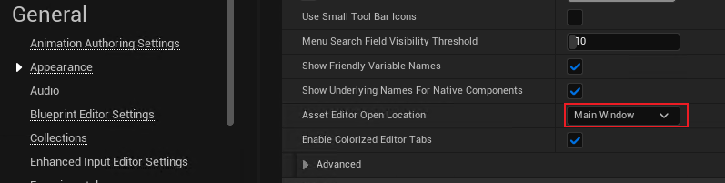

<!--
 * @Author: guanjiajun www.guanjiajun@ewake.com
 * @Date: 2025-07-03 15:44:22
 * @LastEditors: guanjiajun www.guanjiajun@ewake.com
 * @LastEditTime: 2025-07-03 15:51:39
 * @FilePath: \studys\programming\图形学\ue\ue c++\项目新建设置.md
 * @Description: 这是默认设置,请设置`customMade`, 打开koroFileHeader查看配置 进行设置: https://github.com/OBKoro1/koro1FileHeader/wiki/%E9%85%8D%E7%BD%AE
-->
### 新建前设置

### ue C++项目设置

### ue C++编辑器设置

